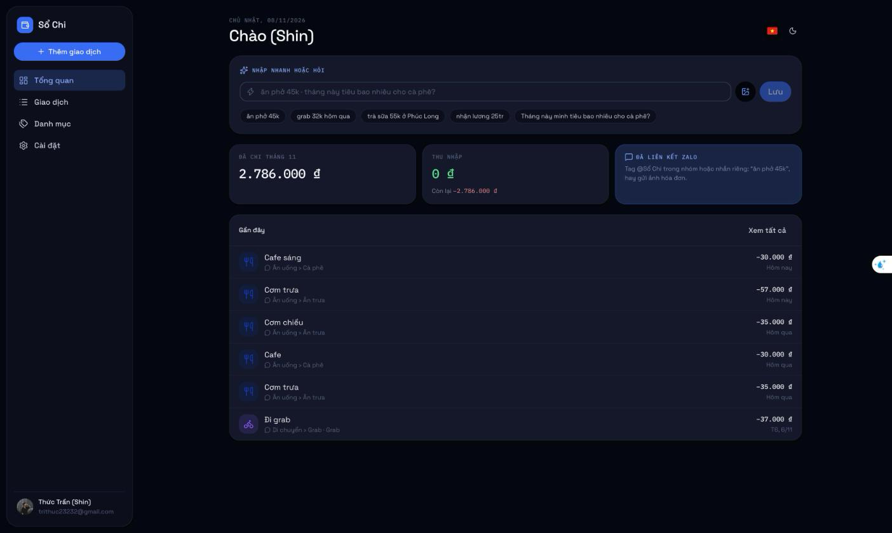
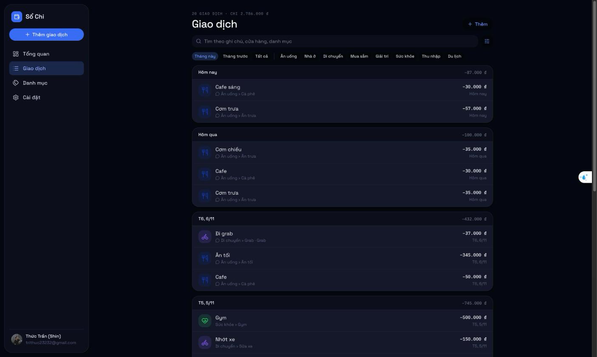
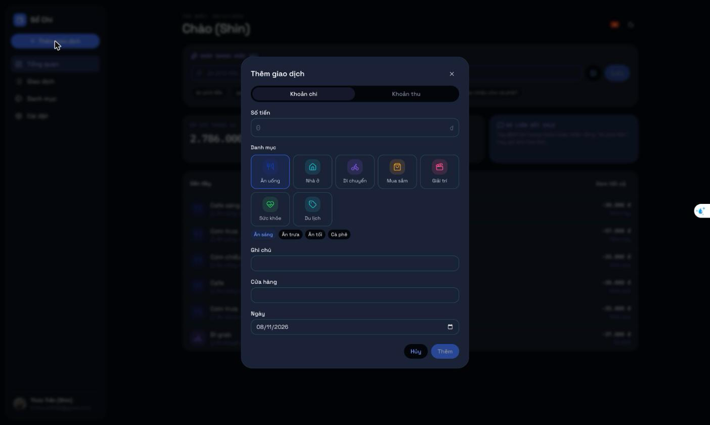
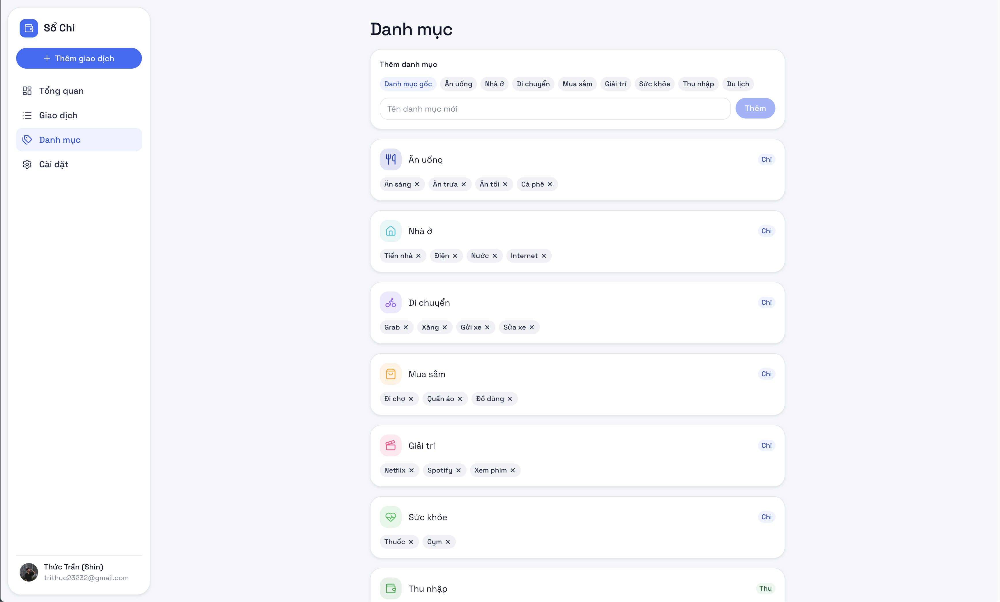
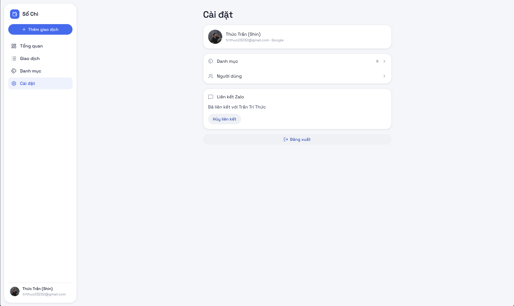
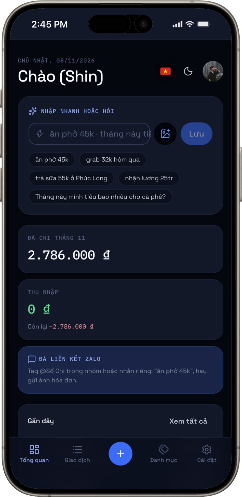
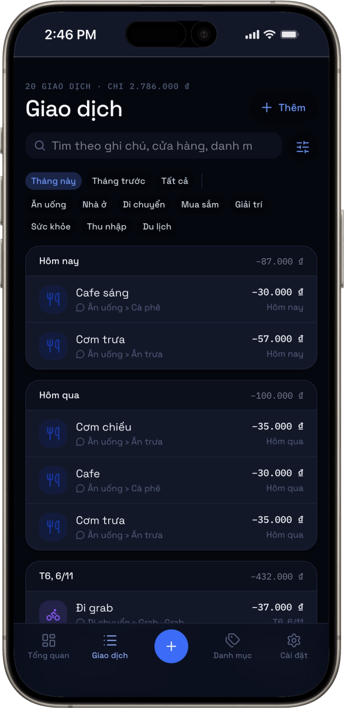
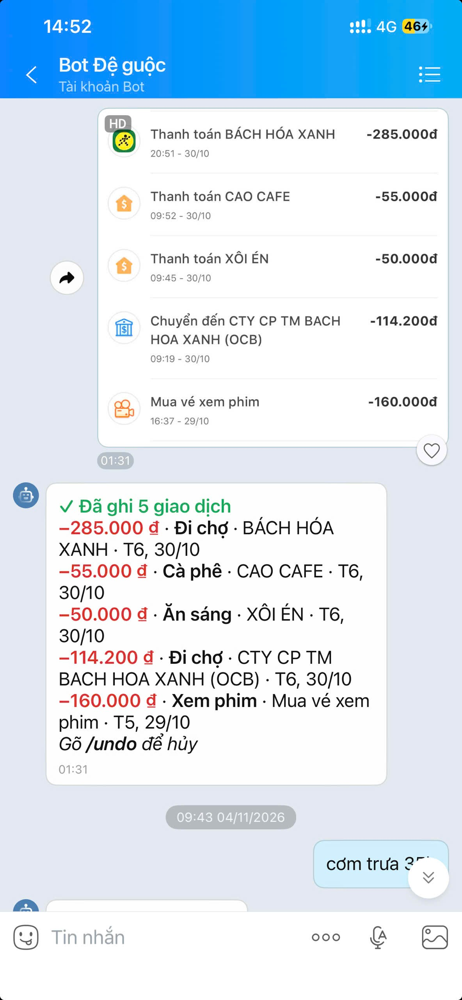

# Sổ Chi — Expense Assistant

A personal expense tracker built for Vietnamese users. Log spending by typing a short Vietnamese sentence ("ăn phở 45k"), snapping a receipt, or simply messaging a **Zalo bot**: it reads the message or receipt photo and records the expense for you.

**Live demo:** [expense.thuctran.blog](https://expense.thuctran.blog/) (sign in with Google)

<p align="center">
  
</p>

## Screenshots

| Transactions                                                | Add transaction                                         |
| ----------------------------------------------------------- | ------------------------------------------------------- |
|  |  |

| Categories                                                | Setting management                                     |
| --------------------------------------------------------- | ------------------------------------------------------ |
|  |  |

| Mobile                                                         | Mobile                                                            |
| -------------------------------------------------------------- | ----------------------------------------------------------------- |
|  |  |

| Zalo bot chat                                       |
| --------------------------------------------------- |
|  |

## Features

- **Natural-language quick entry.** A deterministic Vietnamese parser understands amounts (`45k`, `1tr2`), dates and category keywords. AI is called only when the parser is unsure, and only to choose the category, store and note.
- **Receipt scanning.** Upload a photo or send it to the bot. The AI model extracts line items and creates one transaction per item.
- **Zalo bot.** Link your account with a one-time code from Settings (`/link <code>`). After that you can log expenses from Zalo chats (private or group) and send `/undo` to revert the last entry.
- **Transactions.** Add, edit and delete with undo. The list is grouped by day and can be filtered by period, category, amount range and store, with search.
- **Categories.** Default categories are seeded in the user's language on sign-up. Users can add and remove their own subcategories.
- **Roles and admin.** Sign-up is open with Google. Admins can promote, block, unblock or delete users. Each user has a daily AI usage limit; admins have none.
- **Polished UX.** Installable PWA with iOS splash screens, responsive layout (sidebar on desktop, tab bar and bottom sheets on mobile), pull to refresh, light and dark themes, and Vietnamese and English UI.

## Tech stack

| Area       | Choice                                                               |
| ---------- | -------------------------------------------------------------------- |
| Framework  | Next.js 16 (App Router, Server Components, Server Actions), React 19 |
| UI         | HeroUI v3, Tailwind CSS 4, next-themes, lucide-react                 |
| Data       | PostgreSQL 17, Drizzle ORM and migrations                            |
| Auth       | better-auth (Google OAuth), role-based access                        |
| AI         | OpenAI SDK for text refinement and receipt parsing                   |
| Storage    | Cloudflare R2 (S3 API) for receipt images                            |
| Messaging  | Zalo Bot API via webhook                                             |
| i18n       | next-intl (cookie-based locale, `vi` default, `en`)                  |
| Validation | Zod, react-hook-form                                                 |
| Tooling    | TypeScript, Vitest, oxlint, oxfmt, husky, commitlint                 |
| Deploy     | Vercel (with Vercel Cron), GitHub Actions CI                         |

## Architecture

```
src/
├── app/            Routes: (auth) login, (main) authenticated pages, api/ (auth, Zalo webhook, receipts, cron)
├── proxy.ts        Next 16 proxy: cheap cookie check, real auth happens on the server
├── features/       UI per feature + Server Actions ('use server')
├── server/
│   ├── action.ts   defineAction / defineAdminAction: session → Zod validation → service → typed result
│   ├── services/   All business logic and DB access, always scoped by userId
│   ├── zalo/       Update parsing, intent routing, bot replies
│   ├── ai/         Text and receipt parsing prompts
│   ├── auth/       better-auth config, session helpers, sign-up/block hooks
│   └── db/         Drizzle schema and migrations
└── lib/            Pure helpers: quick-entry parser, dates (Asia/Ho_Chi_Minh), formatting
```

Key design decisions:

- **Typed Server Actions.** Each action goes through one wrapper. It resolves the session, validates input with Zod and returns `{ ok: true, data } | { ok: false, error }`. Services throw coded errors, and the UI turns those codes into translated messages.
- **Data isolation by construction.** Every service function takes `userId` as its first argument, and a dedicated DB test checks that one user can never read or change another user's data.
- **Deterministic first, AI second.** Amounts and dates always come from the rule-based parser, so the AI can't invent money values. AI calls are metered per user per day.
- **Reliable webhook.** The Zalo webhook checks its secret in constant time, ignores duplicate updates by message ID, replies to Zalo immediately and does the slow work afterwards with `after()`.
- **Lazy env validation.** All config is validated with Zod on first use. `next build` and CI run without secrets, while a misconfigured server fails fast with a full list of problems.

## Getting started

Requirements: Node 24, pnpm and Docker.

```bash
pnpm install
docker compose up -d --wait   # Postgres on localhost:5433, creates "expense" and "expense_test"
cp .env.example .env.local    # fill in the values (see below)
pnpm db:migrate
pnpm dev                      # http://localhost:3000
pnpm admin:grant you@gmail.com   # after your first sign-in, make yourself admin
```

### Environment variables

| Variable                                                                 | Notes                                                                                    |
| ------------------------------------------------------------------------ | ---------------------------------------------------------------------------------------- |
| `APP_URL`, `DATABASE_URL`                                                | Defaults in `.env.example` work with Docker Compose                                      |
| `BETTER_AUTH_SECRET`                                                     | `openssl rand -base64 32`                                                                |
| `GOOGLE_CLIENT_ID`, `GOOGLE_CLIENT_SECRET`                               | Google Cloud OAuth client, redirect URI `http://localhost:3000/api/auth/callback/google` |
| `ZALO_BOT_TOKEN`, `ZALO_WEBHOOK_SECRET`                                  | From Zalo Bot Creator; secret must be 8 to 256 characters                                |
| `OPENAI_API_KEY`                                                         | Used for AI parsing                                                                      |
| `R2_ACCOUNT_ID`, `R2_ACCESS_KEY_ID`, `R2_SECRET_ACCESS_KEY`, `R2_BUCKET` | Cloudflare R2 bucket for receipt images                                                  |
| `CRON_SECRET`                                                            | At least 16 characters; protects `/api/cron/*`                                           |
| `AI_DAILY_LIMIT`                                                         | Optional, AI calls per user per day (default 100)                                        |
| `DEV_TUNNEL_HOST`                                                        | Dev only, your ngrok static domain                                                       |

### Zalo bot in development

The Zalo webhook needs a public HTTPS URL. With an ngrok static domain set in `DEV_TUNNEL_HOST`:

```bash
pnpm tunnel         # run next to pnpm dev
pnpm zalo:webhook   # registers https://<DEV_TUNNEL_HOST>/api/zalo/webhook
```

In production, Vercel Cron calls `GET /api/cron/cleanup` daily (see `vercel.json`) to prune old AI usage records and Zalo bot data.

## Scripts

| Command             | Description                                                                                         |
| ------------------- | --------------------------------------------------------------------------------------------------- |
| `pnpm dev`          | Start the dev server                                                                                |
| `pnpm build`        | Production build                                                                                    |
| `pnpm test`         | All tests: unit + database (needs Docker Postgres)                                                  |
| `pnpm test:unit`    | Unit tests only, no database                                                                        |
| `pnpm typecheck`    | Type check                                                                                          |
| `pnpm lint`         | oxlint                                                                                              |
| `pnpm format`       | oxfmt                                                                                               |
| `pnpm db:generate`  | Generate a migration from the Drizzle schema                                                        |
| `pnpm db:migrate`   | Apply migrations                                                                                    |
| `pnpm db:studio`    | Open Drizzle Studio                                                                                 |
| `pnpm admin:grant`  | Grant admin (and unblock): `pnpm admin:grant <email>`; prefix `DATABASE_URL=…` to target production |
| `pnpm tunnel`       | HTTPS tunnel for the Zalo webhook                                                                   |
| `pnpm zalo:webhook` | Register the Zalo bot webhook (optional base URL argument)                                          |

## Quality

CI runs on every pull request: format check, lint, type check, unit and database tests against a real Postgres, and a production build. Commits follow Conventional Commits, enforced by commitlint and lint-staged hooks.
